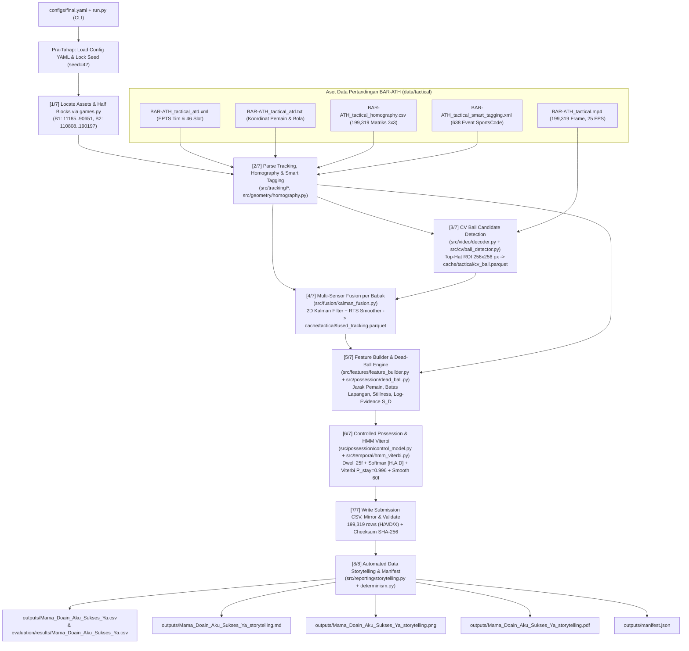

# Dokumentasi Teknologi dan Alur Kerja Sistem

**Proyek:** More Than a Hack 2027 — Phase 1: Ball Possession (`BAR-ATH`)  
**Tim:** Mama Doain Aku Sukses Ya (`Mama_Doain_Aku_Sukses_Ya`)  
**Dokumen Acuan Implementasi:** [`run.py`](run.py), [`src/pipeline.py`](src/pipeline.py), [`configs/final.yaml`](configs/final.yaml)

---

## 1. Gambaran Umum Sistem

Sistem ini adalah pipeline **inferensi penguasaan bola berbasis algoritma fisika, geometri lapangan, visi komputer klasik, fusi Kalman, dan pemodelan sekuensial Hidden Markov Model (HMM)** untuk menghasilkan label per frame (`H`, `A`, `D`, `X`) pada **199.319 frame** video taktis (25 FPS) pertandingan **FC Barcelona vs Athletic Club (`BAR-ATH`)**, sekaligus menyusun **laporan Data Storytelling** secara otomatis.

Berbeda dari pendekatan *black-box* machine learning yang rentan melanggar aturan lomba maupun menghasilkan prediksi yang patah-patah (*flicker*), seluruh keputusan pada sistem ini bersifat **deterministik** (`seed = 42`), **tanpa pelatihan/kalibrasi pada video maupun ground truth pertandingan**, dan dapat direproduksi persis bit-per-bit (`SHA-256` identik).

---

## 2. Teknologi, Perangkat Lunak, dan Metode yang Digunakan

### 2.1 Lingkungan Eksekusi & Standar Library Python

| Komponen | Versi / Modul | Fungsi di Dalam Sistem |
|---|---|---|
| **Bahasa & Runtime** | Python `3.12.13` (`.venv`) | Lingkungan eksekusi utama seluruh modul pipeline, skrip utilitas, dan pengujian. |
| **CLI Parser** | `argparse` (stdlib) | Mengatur argumen eksekusi di [`run.py`](run.py), [`src/pipeline.py`](src/pipeline.py), dan [`src/reporting/storytelling.py`](src/reporting/storytelling.py). |
| **XML Parser** | `xml.etree.ElementTree` (stdlib) | Mem-parsing metadata tim FIFA/EPTS (`BAR-ATH_tactical_atd.xml`) dan 638 interval SportsCode (`BAR-ATH_tactical_smart_tagging.xml`). |
| **Keamanan & Integritas File** | `hashlib` (stdlib) | Menghitung checksum `SHA-256` otomatis atas file CSV submission maupun seluruh artefak storytelling. |
| **Manajemen Berkas & Waktu** | `json`, `shutil`, `datetime`, `os`, `random`, `time` (stdlib) | Penulisan audit [`outputs/manifest.json`](outputs/manifest.json), mirroring file ke `evaluation/results/`, dan penguncian RNG. |

### 2.2 Library Pihak Ketiga yang Terpasang & Terpakai

| Library | Versi Terpasang | Sumber Konfigurasi | Peran Konkret pada Kode |
|---|---|---|---|
| **NumPy** | `2.5.4` | `requirements.txt` | Backbone komputasi vektor 199.319 frame, aljabar matriks Kalman Filter & RTS smoother, jarak Euklides pemain-bola, softmax log-evidence, dan rekursi Viterbi HMM. |
| **Pandas** | `3.1.1` | `requirements.txt` | Membaca matriks homografi CSV, menulis/membaca tabel cache DataFrame, serta validasi & pembacaan CSV submission lewat [`evaluation/possession_metrics.py`](evaluation/possession_metrics.py). |
| **OpenCV (`opencv-python-headless`)** | `5.0.0.93` | `requirements-pipeline.txt` | Dekoder streaming video in-memory (`cv2.VideoCapture` di [`src/video/decoder.py`](src/video/decoder.py)) serta pemrosesan citra CV (`cvtColor`, `MORPH_ELLIPSE`, `MORPH_TOPHAT`, `threshold`, `findContours`, `contourArea`, `boundingRect`, `arcLength`) di [`src/cv/ball_detector.py`](src/cv/ball_detector.py). |
| **PyArrow** | `26.0.1` | `requirements-pipeline.txt` | Serialisasi format kolumnar **Apache Parquet** (`cv_ball.parquet` dan `fused_tracking.parquet`) di `cache/tactical/` agar proses ulang selesai dalam ~15 detik. |
| **PyYAML** | `6.0.3` | `requirements-pipeline.txt` | Membaca seluruh parameter terpusat dari [`configs/final.yaml`](configs/final.yaml) lewat [`src/utils/config.py`](src/utils/config.py). |
| **Matplotlib** | `3.11.2` | `.venv` (digunakan oleh `storytelling.py`) | Backend headless `Agg` (dengan `MPLCONFIGDIR` ke `cache/matplotlib`) untuk menghasilkan dashboard grafik 2x2 resolusi tinggi (200 DPI PNG) pada [`src/reporting/storytelling.py`](src/reporting/storytelling.py). |
| **ReportLab** | `5.1.0` | `.venv` (digunakan oleh `storytelling.py` & `generate_pdf_report.py`) | Menyusun dokumen PDF terstruktur (tabel, gambar dashboard tertanam, header/tipografi) pada `*_storytelling.pdf` dan PDF laporan teknis. |
| **Pytest** | `9.2.0` | `requirements-pipeline.txt` | Framework unit testing otomatis di folder [`tests/`](tests/) dengan konfigurasi [`pytest.ini`](pytest.ini) (`pythonpath = .`). |

> **Catatan Paket Tambahan di `requirements-pipeline.txt`:** `scipy==1.18.1` dan `filterpy==2.0.0` terpasang pada `.venv`, namun pada implementasi final modul [`src/fusion/kalman_fusion.py`](src/fusion/kalman_fusion.py) menerapkan persamaan Kalman Filter 2D & RTS backward smoother secara langsung di atas matriks `numpy` murni demi kontrol gating dan efisiensi penuh tanpa overhead eksternal. Paket `matplotlib` dan `reportlab` dibutuhkan apabila fitur pelaporan PDF/chart diaktifkan (default aktif; dapat dilewati via flag `--no-report`).

### 2.3 Teknologi Algoritmik & Pemodelan Matematika

1. **Geometri Proyektif (Homografi `3x3`)**  
   Memetakan koordinat lapangan ternormalisasi `(0..1)` maupun metrik `(105.3m x 68.0m)` ke koordinat piksel `(u, v)` dan sebaliknya lewat invers matriks homografi `inv(H)`. Digunakan untuk mengarahkan Region of Interest (ROI) deteksi visual CV dan memproyeksikan kandidat bola kembali ke meter lapangan.
2. **Computer Vision Klasik Berbasis ROI (Morphological Top-Hat + Contour Filtering)**  
   Hanya membaca frame video saat *gameplay* aktif di mana bola ATD hilang dan pemain bergerak (`mean_player_speed >= 1.5 m/s`). Pada potongan gambar **`256 x 256` piksel** di sekitar estimasi posisi bola terakhir, sistem mencari objek kecil terang berbentuk bulat (diameter bola ~6–14 piksel pada video 1080p) dengan transformasi morfologi `MORPH_TOPHAT` elips `9x9`, thresholding biner (`40`), filter luas kontur (`10–180 px`), rasio aspek (`0.6–1.6`), uji batas lapangan (+3 m margin), dan skor gabungan kebulatan + kecerahan (`confidence >= 0.40`).
3. **Sensor Fusion dengan 2D Constant-Velocity Kalman Filter & RTS Backward Smoother**  
   Menggabungkan koordinat **ATD** (`R_ATD = 0.25 m²`) dan deteksi **CV** (`R_CV_BASE = 0.64 m²`, diskalakan dengan `reprojection_error` dan `cv_conf`) pada vektor state `[x, y, vx, vy]`. Dilengkapi *outlier speed gating* (`45.0 m/s`), fusi bobot invers kovariansi jika selisih ATD–CV `< 3.0 m`, prediksi *coasting* maksimal `25` frame saat sensor hilang, dan penghalusan mundur **Rauch–Tung–Striebel (RTS)** per babak.
4. **Rule Engine Fisika & Konteks Bola Mati (*Dead-Ball Engine*)**  
   Menilai log-evidence kondisi Bola Mati (`D`) menggunakan batas garis lapangan (`outside_margin_m > 0.0 m`), kesenyapan kolektif pemain (`mean_speed < 1.35 m/s` dan `frac_players_walking > 0.65`), pemisahan separuh lapangan pra-*kickoff* (`own_half_separation >= 0.80`), jendela pascagol, serta penekan aktif jika ada pemain berlari cepat (`mean_speed >= 1.8 m/s`) dekat bola.
5. **Model Penguasaan Bola Terkendali (*Anti-Deflection Dwell State Machine*)**  
   Menghitung skor kedekatan eksponensial `exp(-d / 2.5) * 4.0`, margin keunggulan jarak antar tim, prior ofensif/defensif SportsCode (`st_prior_weight = 1.2`), serta mesin status anti-pantulan yang mewajibkan tim lawan memegang jarak terdekat minimal **`25` frame (`1.0 detik`)** sebelum pergantian penguasaan sah terjadi (atau reset setelah bola liar > `35` frame).
6. **3-State Hidden Markov Model (HMM) + Decoding Viterbi Eksak**  
   Menemukan urutan state global paling mungkin `{H, A, D}` di ruang logaritma per babak secara independen dengan matriks transisi realistis sepak bola (`P_stay = 0.996`, `P_switch = 0.002`) dan filter mayoritas terpusat (`smoothing_window = 60` frame) untuk menghilangkan osilasi mikro.
7. **Automated Data Storytelling Pipeline**  
   Mengubah urutan label diskret menjadi ringkasan pertandingan yang mudah dipahami publik (proporsi bola hidup vs mati, durasi rata-rata/median/maksimum per *spell*, profil gaya bermain `<5s` / `5-15s` / `>=15s`, pergeseran momentum per fase ~15 menit, 5 *spell* terpanjang, serta tabel arti metrik evaluasi publik), lalu mengekspor ke **Markdown**, **Chart Dashboard PNG**, dan **PDF**.

---

## 3. Diagram Alur Sistem End-to-End



---

## 4. Penjelasan Detail Alur Eksekusi Sistem

Alur kerja utama dikendalikan oleh [`run.py`](run.py) yang memanggil fungsi [`run_pipeline`](src/pipeline.py#L38-L276) dengan urutan eksekusi berikut:

### Pra-Tahap: Konfigurasi & Determinisme
1. [`load_config`](src/utils/config.py#L11-L19) memuat parameter dari [`configs/final.yaml`](configs/final.yaml).
2. [`set_seed(42)`](src/utils/determinism.py#L12-L25) mengunci `PYTHONHASHSEED`, `random`, dan `np.random` agar setiap eksekusi selalu menghasilkan keluaran identik.

### Tahap `[1/7]` — Resolusi Aset & Blok Pertandingan
- Memanggil `games.require(["atd_meta", "atd_raw", "homography", "smart_tagging", "video"], game="BAR-ATH")` pada [`games.py`](games.py).
- Mengambil indeks blok video per babak dari `games.half_video_blocks("BAR-ATH")`:
  - **Babak 1:** frame video `11.185` s.d. `90.651` (offset ID `1.702.057`)
  - **Babak 2:** frame video `110.808` s.d. `190.197` (offset ID `1.702.058`)
- Frame di luar kedua blok tersebut (pra-laga, jeda turun minum, pasca-laga) ditetapkan sebagai frame luar laga (`X`). Aset *broadcast video/ATD* (`164.488` frame) tidak dipakai karena timeline-nya tidak sinkron terhadap otoritas frame taktis (`199.319` frame).

### Tahap `[2/7]` — Parsing Data Tracking, Homografi, & Smart Tagging
1. **Metadata & ATD ([`src/tracking/atd_loader.py`](src/tracking/atd_loader.py)):**  
   - `load_team_mapping` memetakan 46 slot pemain ke `HOME` (`Barcelona`) dan `AWAY` (`Atletic Club`).  
   - `parse_tactical_atd` mengonversi indeks `video_frame = frame_id - 1`, menskalakan koordinat ternormalisasi ke meter nyata (`105.3 x 68.0 m`), menghitung kecepatan rata-rata pemain, dan mengidentifikasi bola ATD tampak pada **113.488 / 199.319 frame (56,9%)**.
2. **Homografi ([`src/geometry/homography.py`](src/geometry/homography.py)):**  
   - `load_homography` memuat **199.319 matriks `3x3`** beserta galat reproyeksi rata-rata **`0.42 px`**.
3. **Smart Tagging ([`src/tracking/smart_tagging.py`](src/tracking/smart_tagging.py)):**  
   - `parse_smart_tagging` membaca **638 interval XML** SportsCode, mengonversi detik ke frame (`round(sec * 25.0)`), lalu `build_frame_priors` mengubah kode ofensif (`BUILD UP`, `PROGRESSION`, `CREATING CHANCES`, dll.) dan kode defensif (`DEFENDING IN ...` terbalik ke tim lawan) menjadi sinyal prior `[0, 1]` serta menandai interval `SET PIECES`, *kick-off*, dan *goal window*.

### Tahap `[3/7]` — Deteksi Kandidat Bola via Computer Vision
- Dijalankan oleh [`extract_cv_ball_table`](src/cv/ball_detector.py#L90-L208) memakai [`VideoChunkDecoder`](src/video/decoder.py#L10-L66).
- Jika file cache `cache/tactical/cv_ball.parquet` tersedia (dan `--force-recompute` tidak aktif), hasil CV langsung dimuat dari Parquet.
- Bila dihitung ulang dari video: sistem mencari segmen *gameplay* aktif saat bola ATD hilang dan rata-rata kecepatan pemain `>= 1.5 m/s`, memproyeksikan posisi bola terakhir ke piksel dengan homografi, memotong ROI **`256 x 256` piksel**, dan menyaring kandidat memakai morfologi *Top-Hat* hingga memperoleh **10.792 frame deteksi CV** (`confidence >= 0.40`).

### Tahap `[4/7]` — Fusi Sensor Kalman Filter & RTS Smoother
- Dijalankan per babak oleh [`fuse_ball_tracking`](src/fusion/kalman_fusion.py#L86-L236) dan disimpan ke `cache/tactical/fused_tracking.parquet`.
- Pada tiap frame:
  - Jika ATD & CV keduanya valid dan jarak `< 3.0 m`, dilakukan fusi presisi berbasis invers kovariansi (`R_ATD` vs `R_CV`).
  - Jika selisih `>= 3.0 m`, sensor yang lebih dekat ke prediksi Kalman dipilih.
  - Jika hanya ATD yang tersedia, sistem memeriksa lompatan jarak (`implied_speed <= 45.0 m/s`) untuk menolak *outlier*.
  - Jika kedua sensor hilang, filter melakukan *coasting* posisi secara fisik hingga maks **`25` frame** (`1.0 detik`).
- Setelah lintasan maju selesai dalam satu babak, **RTS Backward Smoother** menghaluskan posisi & vektor kecepatan `[x, y, vx, vy]` sehingga total cakupan posisi bola valid menjadi **108.764 / 199.319 frame (54,6%)**.

### Tahap `[5/7]` — Rekayasa Fitur & Dead-Ball Engine
1. [`build_frame_features`](src/features/feature_builder.py#L15-L123) menghitung per frame: jarak pemain terdekat tim Home (`nearest_home_dist_m`) dan Away (`nearest_away_dist_m`), selisih margin jarak, jumlah pemain dalam radius `2 m` & `4 m`, margin bola keluar garis lapangan (`outside_margin_m`), fraksi pemain berjalan (`speeds < 1.3 m/s`), metrik pemisahan babak pra-kickoff (`own_half_separation`), dan menggabungkan prior Smart Tagging.
2. [`compute_dead_ball_scores`](src/possession/dead_ball.py#L8-L71) menghitung skor log-evidence Bola Mati `score_d` berdasarkan bola di luar garis (`> 0.0 m`), kesenyapan kolektif pemain (`mean_speed < 1.35 m/s` & `frac_walking > 0.65`), bola hilang saat tempo lambat, fase pra-kickoff / pascagol, serta penekan ketika pemain beradu lari cepat dekat bola.

### Tahap `[6/7]` — Emisi Penguasaan Bola & HMM Viterbi Decoder
1. [`compute_emission_probabilities`](src/possession/control_model.py#L14-L128) mengevaluasi setiap frame:
   - Jika `score_d > 1.0`, status kepemilikan aktif di-reset ke `NONE`.
   - Jika bola hidup, dihitung skor dasar `H` dan `A` dari kedekatan eksponensial + margin jarak + prior Smart Tagging + bonus persistensi (`+2.0`).
   - Tim lawan baru bisa merebut kepemilikan jika terus berada paling dekat dengan bola (radius `< 2.5 m` dan unggul `> 0.5 m`) minimal **`25` frame berturut-turut**.
   - Ketiga skor `[S_H, S_A, S_D]` diubah menjadi probabilitas emisi via fungsi **softmax**.
2. [`decode_full_match`](src/temporal/hmm_viterbi.py#L53-L104) menjalankan algoritma **Viterbi log-space** terpisah untuk Babak 1 dan Babak 2 memakai matriks transisi `[H, A, D]` (`P_stay = 0.996`), lalu menerapkan filter mayoritas terpusat (`smoothing_window = 60` frame), sedangkan semua frame di luar babak dibiarkan **`X`**.

### Tahap `[7/7]` — Penulisan Output CSV, Validasi, & Checksum
- Menulis **199.319 baris** (`frame,label`) ke [`outputs/Mama_Doain_Aku_Sukses_Ya.csv`](outputs/Mama_Doain_Aku_Sukses_Ya.csv) dan menyalin salinan identik ke `evaluation/results/Mama_Doain_Aku_Sukses_Ya.csv`.
- Menjalankan validasi format resmi [`evaluation/possession_metrics.py`](evaluation/possession_metrics.py) (`validate_submission`) dan mencetak ringkasan distribusi (`H: 56.110`, `A: 38.249`, `D: 64.498`, `X: 40.462`, **358** *possession spells*, rata-rata **10,5 detik**, `SHA-256: 59f0cff74f3fa39df74c9bae3f724c9d9ef3d4dc8f3ebdb695e0d9ba6190a914`).

### Tahap `[8/8]` — Data Storytelling & Audit Manifest
- Jika `reporting.generate_storytelling` bernilai `true` dan `--no-report` tidak diberikan, fungsi [`generate_all_storytelling_artifacts`](src/reporting/storytelling.py#L627-L678) menghitung seluruh metrik pertandingan dan secara otomatis menghasilkan:
  1. [`outputs/Mama_Doain_Aku_Sukses_Ya_storytelling.md`](outputs/Mama_Doain_Aku_Sukses_Ya_storytelling.md) — narasi analisis pertandingan, tabel *head-to-head*, tabel momentum per babak dan per ~15 menit, 5 *top spells*, serta glosarium metrik publik.
  2. [`outputs/Mama_Doain_Aku_Sukses_Ya_storytelling.png`](outputs/Mama_Doain_Aku_Sukses_Ya_storytelling.png) — dashboard visual 2x2 panel (Distribusi Waktu, Momentum 15 Menit, Profil Gaya Penguasaan, Top 5 *Spells*).
  3. [`outputs/Mama_Doain_Aku_Sukses_Ya_storytelling.pdf`](outputs/Mama_Doain_Aku_Sukses_Ya_storytelling.pdf) — laporan ringkas siap presentasi.
- Tahap terakhir memanggil [`save_manifest`](src/utils/determinism.py#L39-L61) untuk merekam konfigurasi penuh, timestamp eksekusi, ukuran file, dan hash `SHA-256` seluruh keluaran ke [`outputs/manifest.json`](outputs/manifest.json).

---

## 5. Peta Struktur Modul Kode Proyek

```text
more-than-a-hack-2027/
├── run.py                                  # Entrypoint CLI utama (--config, --output, --force-recompute, --no-report)
├── games.py                                # Konstanta pertandingan, frame alignment, dan lokasi aset BAR-ATH
├── configs/
│   └── final.yaml                          # Konfigurasi parameter terpusat untuk semua subsistem
├── src/
│   ├── pipeline.py                         # Orkestrator pipeline end-to-end [1/7] s.d. [8/8]
│   ├── utils/
│   │   ├── config.py                       # Loader file konfigurasi YAML
│   │   └── determinism.py                  # Seed locking, SHA-256, dan manifest generator
│   ├── tracking/
│   │   ├── atd_loader.py                   # Streaming parser ATD raw & EPTS XML metadata
│   │   └── smart_tagging.py                # Parser SportsCode XML & konversi prior frame
│   ├── geometry/
│   │   └── homography.py                   # Proyeksi 3x3 pixel <-> pitch metric & perhitungan margin garis
│   ├── video/
│   │   └── decoder.py                      # Streaming pembaca frame video in-memory via OpenCV
│   ├── cv/
│   │   └── ball_detector.py                # Detektor kandidat bola Morphological Top-Hat pada ROI
│   ├── fusion/
│   │   └── kalman_fusion.py                # 2D Kalman Filter + RTS Backward Smoother (ATD + CV)
│   ├── features/
│   │   └── feature_builder.py              # Builder fitur spasial, kinematik, batas lapangan, dan prior
│   ├── possession/
│   │   ├── dead_ball.py                    # Log-evidence scoring kondisi Bola Mati (D)
│   │   └── control_model.py                # Probabilitas emisi [H, A, D] & aturan anti-deflection dwell
│   ├── temporal/
│   │   └── hmm_viterbi.py                  # 3-State HMM Viterbi Decoder & smoothing terpusat
│   └── reporting/
│       └── storytelling.py                 # Generator analitik Data Storytelling (Markdown, PNG, PDF) + CLI mandiri
├── outputs/                                # CSV submission, laporan PDF/MD/PNG, manifest.json
├── cache/                                  # Cache Parquet CV & Fused Tracking serta cache font Matplotlib
├── evaluation/                             # Validator format resmi & skrip evaluasi jendela publik 5 menit
└── tests/                                  # 13 unit test otomatis (alignment, homography, kalman, hmm, storytelling)
```

---

## 6. Perintah Eksekusi & Verifikasi

```powershell
# 1. Jalankan pipeline lengkap (inferensi CSV + validasi + Data Storytelling MD/PNG/PDF)
.\.venv\Scripts\python.exe run.py --config configs\final.yaml

# 2. Jalankan pipeline penuh dengan menghitung ulang CV & Kalman (abaikan cache Parquet)
.\.venv\Scripts\python.exe run.py --config configs\final.yaml --force-recompute

# 3. Buat laporan Data Storytelling saja dari CSV submission yang sudah ada
.\.venv\Scripts\python.exe -m src.reporting.storytelling --csv outputs\Mama_Doain_Aku_Sukses_Ya.csv

# 4. Validasi format submission resmi & evaluasi jendela publik 5 menit
.\.venv\Scripts\python.exe evaluation\validate_submission.py outputs\Mama_Doain_Aku_Sukses_Ya.csv
.\.venv\Scripts\python.exe evaluation\run_evaluation.py

# 5. Jalankan seluruh unit test otomatis
.\.venv\Scripts\pytest.exe
```

